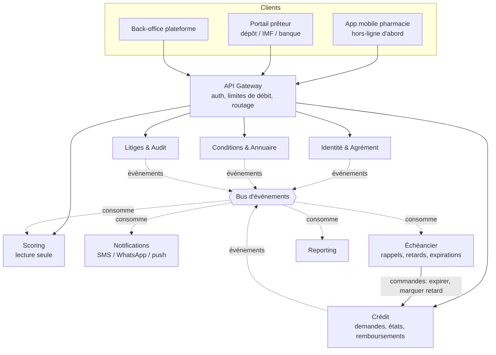

# Architecture micro-services

Cible : une plateforme de suivi de crédit entre pharmacies et prêteurs (dépôts, IMF, banques), disponible même quand une partie du système tombe.
Le prototype actuel (`validation-depots/`) est un monolithe. Ce document découpe ses responsabilités et décrit comment les déployer.

## Règle d'architecture structurante

**Aucun service ne détient, ne transfère ni ne déclenche de paiement.** Il n'existe donc pas de service « paiement », « portefeuille » ou « Mobile Money ». Les montants ne sont que des écritures déclaratives dans le service Crédit. Cette règle est un invariant à protéger en revue de code et dans le schéma de données, parce qu'elle fonde le positionnement réglementaire.

## Vue d'ensemble

## Services et responsabilités

| Service | Responsabilité unique | Données (base propre) | Ne fait pas |
|---|---|---|---|
| **Identité & Agrément** | Inscription des pharmacies et prêteurs, vérification d'agrément (KYB), jetons, rôles | acteurs, documents d'agrément, sessions | Aucune logique de crédit |
| **Conditions & Annuaire** | Conditions de chaque prêteur (paliers, tolérance, délais), validation et versionnage, annuaire public | conditions versionnées | Ne calcule pas de score |
| **Crédit** (cœur) | Machine à états de la demande, plafond appliqué à la validation, remboursements constatés, historique | demandes, remboursements, journal d'états | Pas de notification, pas de rappel |
| **Scoring** | Palier, plafond, disponible, retards par relation prêteur-pharmacie | projection reconstruite depuis les événements | Ne décide rien, ne modifie aucune demande |
| **Échéancier** | Déclenche rappels, passage en retard, expiration des demandes sans réponse | jobs planifiés | Ne détient pas l'état des demandes |
| **Notifications** | Envoi SMS/WhatsApp/push, modèles de messages, reprises sur échec | journal d'envoi | Aucune règle métier |
| **Litiges & Audit** | Contestation d'un remboursement par la pharmacie, journal immuable | litiges, journal d'audit append-only | Ne modifie pas le solde seul : il émet une demande de correction au service Crédit |
| **Reporting** | Tableaux de bord prêteurs et plateforme, exports | entrepôt en lecture | Aucune écriture métier |

Chaque service possède sa base. Aucun accès direct à la base d'un autre : seuls l'API et les événements traversent les frontières.

## Communication

- **Synchrone (HTTP/gRPC)** uniquement pour les actions où l'utilisateur attend la réponse : soumettre, valider, rembourser, lire.
- **Asynchrone (événements)** pour tout le reste : scoring, notifications, rappels, reporting. Une panne de ces services ne bloque jamais le parcours principal.
- Événements principaux : `DemandeSoumise`, `DemandeValidee`, `DemandeRefusee`, `MarchandiseLivree`, `MarchandiseRecue`, `RemboursementConstate`, `DemandeCloturee`, `RetardConstate`, `ConditionsModifiees`, `LitigeOuvert`.
- **Outbox transactionnelle** : le service Crédit écrit son changement d'état et l'événement dans la même transaction, puis un relais publie. Pas d'événement perdu ni de double écriture.
- **Idempotence** : chaque commande d'écriture (`rembourser` surtout) porte une clé d'idempotence. Un SMS ou un réseau instable qui provoque un renvoi ne doit jamais enregistrer deux fois le même remboursement.

## Point de décision : le plafond à la validation

À la validation, le plafond doit être vérifié sans risque de course ni de panne d'un autre service. Deux crédits validés au même instant ne doivent pas dépasser le plafond ensemble.

Recommandation : le service **Crédit** garde, pour chaque relation prêteur-pharmacie, ses propres compteurs (encours, retards, série) mis à jour dans la même transaction que les états. La vérification du plafond est alors locale et atomique, sans appel réseau.
Le service **Scoring** est une vue de lecture pour les affichages (palier, prochain plafond, simulation) et le reporting, pas le point de décision. Cela évite qu'une panne de Scoring bloque les validations.

La logique de palier (aujourd'hui dans `scoring.js`) est une bibliothèque pure partagée par les deux services, versionnée avec les conditions.

## Disponibilité

- **Services sans état**, au moins 2 instances chacun, répartis sur plusieurs zones de disponibilité.
- **Bases répliquées** avec bascule automatique, sauvegardes chiffrées testées par restauration régulière.
- **Bus d'événements** en grappe avec rétention, pour rejouer les événements après une panne.
- **Isolation des pannes** : délais d'attente, reprises avec attente exponentielle, coupe-circuit sur tous les appels sortants. Les consommateurs d'événements sont tolérants au retard.
- **Dégradation prévue** :
  - Scoring ou Reporting en panne : le parcours de crédit continue.
  - Notifications en panne : les messages sont mis en file et partent au retour.
  - Échéancier en panne : les retards sont rattrapés au redémarrage, car il recalcule depuis les dates d'échéance.
  - Identité en panne : les jetons déjà émis restent valables jusqu'à expiration (jetons signés, vérifiés localement par la passerelle).
- **Application mobile hors-ligne d'abord** : la pharmacie prépare sa demande sans connexion, elle est envoyée dès que le réseau revient, avec la clé d'idempotence. Important en RDC où la connectivité est irrégulière.
- **Observabilité** : journaux structurés avec identifiant de corrélation, métriques (latence, erreurs, retard de consommation du bus), traces distribuées, alertes sur le délai de validation et sur les messages en file.
- **Objectifs à fixer** : par exemple 99,9 % pour Crédit et la passerelle, plus souple pour Reporting.

## Sécurité et conformité

- Passerelle : authentification, limites de débit, validation de schéma. Les services internes n'acceptent que du trafic de la passerelle ou du maillage (mTLS).
- Isolation des données : un prêteur n'accède qu'à ses propres demandes et à sa propre relation avec une pharmacie. Contrôle appliqué dans chaque service, pas seulement à la passerelle.
- Secrets dans un coffre dédié, jamais dans le code. Chiffrement des données au repos et en transit.
- Journal d'audit immuable des décisions : qui a validé quoi, avec quelles conditions figées.
- Données personnelles minimales : pas de pièces d'identité dans le service Crédit.

## Mise en œuvre progressive

Ne pas tout séparer d'emblée : cela coûte cher en exploitation pour une petite équipe.

1. **Phase 1, monolithe modulaire (fait, voir `validation-depots/`)** : un seul déploiement, mais avec les modules Identité, Conditions, Crédit, Scoring séparés (mêmes frontières que ci-dessus, bases par schéma). C'est le prototype actuel, rangé en modules. L'outbox et l'idempotence sont en place, et un test protège les frontières entre modules.
2. **Phase 2, extraire les services asynchrones (fait)** : Notifications puis Échéancier, car ils sont naturellement découplés et une panne y est sans gravité. Ils lisent le flux d'événements de Crédit en HTTP, avec leur propre curseur ; le passage à un bus (NATS, RabbitMQ) se fera sans changer leur logique.
3. **Phase 3, extraire Identité et Conditions** quand les prêteurs commencent à s'inscrire eux-mêmes et à changer de conditions.
4. **Phase 4, Litiges, Reporting et Scoring séparés**, quand le volume ou les équipes le justifient.
5. **Garder Crédit unique et robuste** : c'est la source de vérité, à ne découper que si la charge l'impose.

## Technologies suggérées (à adapter)

| Besoin | Option |
|---|---|
| Services | Node.js ou Go, contrats d'API OpenAPI |
| Base de données | PostgreSQL par service, réplication native |
| Bus d'événements | NATS JetStream ou RabbitMQ pour démarrer, Kafka si le volume le justifie |
| Passerelle | Kong, Traefik ou Envoy |
| Déploiement | Conteneurs, Kubernetes ou service géré, IaC |
| Observabilité | OpenTelemetry, Prometheus, Grafana, Loki |
| SMS / WhatsApp | Fournisseur local ou agrégateur, derrière une interface interchangeable |

## Interface web

Le dossier `web/` contient l'interface (Next.js) : espaces pharmacie, prêteur et administration. Elle joue le rôle de **BFF** (Backend For Frontend) : le navigateur ne parle qu'au serveur Next, qui appelle la plateforme par le réseau interne avec le jeton de l'utilisateur, conservé dans un cookie `httpOnly`. Quand la passerelle d'API existera, le front la remplacera comme seul point d'appel. Voir `web/README.md`.

## Application mobile

Le dossier `mobile/` contient l'application **Flutter pour les pharmacies** uniquement (les prêteurs et l'administration restent sur le web). Contrairement au front web, elle n'a pas de BFF : elle appelle directement la plateforme avec le jeton de session, conservé dans le stockage sécurisé du téléphone (Keychain / Keystore). Quand la passerelle d'API existera, elle deviendra son seul point d'appel.

**Hors ligne d'abord.** Les pharmacies travaillent avec un réseau instable, donc :
- Lecture : réseau d'abord, dernière copie enregistrée sinon, avec un bandeau qui dit de quand elle date.
- Écriture (demander, confirmer une réception, annuler) : envoyée tout de suite, sinon gardée dans une file persistante et renvoyée dans l'ordre. Chaque action garde **la même clé d'idempotence** à chaque tentative, donc un renvoi ne crée jamais de doublon.
- Une erreur de la plateforme (plafond dépassé, demande déjà traitée) n'est jamais mise en file : elle est montrée tout de suite. Si elle arrive au renvoi, l'action est retirée et signalée à l'utilisateur avec la raison.

**Couches** (`mobile/lib/`) : `domaine/` (modèles), `donnees/` (dépôts, file d'attente), `core/` (réseau, stockage, formats), `etat/` (Riverpod, routeur), `presentation/` (écrans et composants). Les règles de crédit restent **toutes** sur la plateforme : l'application affiche et transmet, elle ne calcule aucun plafond.

**Limites connues.** La session dure 12 h côté plateforme (un nouveau code SMS est demandé chaque jour). Le build Android n'a pas été vérifié ici (SDK Android non installé) ; l'application a été vérifiée par tests et dans un navigateur. iOS s'ajoute avec `flutter create --platforms ios .`. Voir `mobile/README.md`.

## Structure du code et haute disponibilité

**Principe.** Chaque responsabilité a son dossier, et les dépendances ne vont que dans un sens. Ce découpage permet d'extraire un service sans réécrire la logique métier, et protège les règles de crédit de tout détail technique.

**Plateforme** (`validation-depots/src/`)
- `contextes/` : une responsabilité métier par dossier (identité, conditions, scoring, crédit, administration). Chaque contexte expose un `index.js` et ne dépend que des contextes autorisés.
- `transverse/` : outils sans métier (erreurs, bus d'événements, idempotence).
- `interfaces/http/` : entrée HTTP, sans règle métier.
- `app.js` : racine de composition, la seule à relier les pièces.

**Services** (`validation-depots/services/`) : chacun suit les couches `domaine`, `application` et `infrastructure`.

**Garde-fous.** `test/frontieres.test.js` vérifie ces règles à chaque lancement des tests. Une dépendance interdite (par exemple un contexte qui importe l'interface HTTP, ou le domaine d'un service qui importe l'infrastructure) fait échouer le build. Ce test a été vérifié en injectant volontairement ces violations.

**État réel de la haute disponibilité.** Le découpage prépare la montée en charge, mais aujourd'hui le système ne peut pas tourner sur plusieurs instances :

| Exigence | État actuel | Ce qu'il faut |
|---|---|---|
| Plusieurs instances de la plateforme | Non. L'état vit en mémoire et dans un fichier JSON par module, réécrit en entier à chaque changement. Une seule instance peut écrire. | Base PostgreSQL avec transactions. |
| Indépendance vis-à-vis du stockage | Les contextes lisent et écrivent directement `stockage.donnees` (11 accès dans identité, conditions, crédit, administration et idempotence). | Ports *repository* par agrégat, d'abord implémentés en fichier (comportement inchangé), puis en PostgreSQL. C'est la dette structurelle la plus importante. |
| Bus d'événements | L'outbox est relayée par le processus de la plateforme. Une seconde instance publierait en double. | Un seul relais actif (verrou), ou `SELECT … FOR UPDATE SKIP LOCKED` sur la table d'outbox. |
| Limites anti-abus | En mémoire, par instance. | Un magasin partagé (Redis). |
| Notifications et Échéancier en plusieurs instances | Chacun écrit dans son fichier local : deux instances enverraient deux fois le même SMS. | Base partagée, avec attribution des messages par `SKIP LOCKED`. Les clés d'idempotence restent utiles. |
| Reprise après panne | Copie du volume, sans réplication. | PostgreSQL répliqué, sauvegardes testées par restauration. |
| Déploiement sans coupure | Un conteneur par service. | Plusieurs réplicas derrière un répartiteur. Les sondes `/sante` sont déjà en place. |

**Déjà en place** et utile à la haute disponibilité : sondes de santé, clés d'idempotence sur les écritures sensibles, outbox avec curseur par consommateur, reprises avec attente croissante, isolation des services (une panne de Notifications ne bloque aucun crédit), et tests de pannes dans le test d'intégration.

**Ordre conseillé.**
1. Ports *repository* sur les contextes, avec l'implémentation fichier actuelle : le comportement ne change pas, mais le couplage disparaît.
2. Adaptateur PostgreSQL et transactions.
3. Relais d'outbox avec verrou.
4. Notifications et Échéancier sur la même base.
5. Réplicas, répartiteur et limites partagées.

## Points à décider

- Hébergement : cloud étranger, hébergement local en RDC, ou hybride, selon les exigences de localisation des données.
- Qui exploite quoi : si les banques et IMF exigent leur propre environnement, un déploiement par prêteur est possible mais multiplie l'exploitation.
- Contestation des remboursements : délai et règles de résolution, à fixer avec les prêteurs.
- Centrale d'information de crédit : si elle existe ou se crée en RDC, un service d'échange avec elle viendrait s'ajouter, sous cadre légal.
