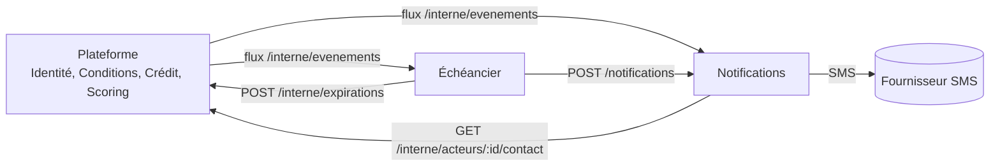

# Suivi de crédit de proximité : dépôts, IMF et banques

Un prêteur (dépôt pharmaceutique, IMF ou banque) valide lui-même chaque demande d'une pharmacie, avance le produit et reçoit le remboursement directement d'elle.
Chaque prêteur fixe ses propres conditions et fait son propre suivi. La plateforme applique ces conditions et tient le suivi.

## Structure par responsabilité

Un seul déploiement pour la plateforme, mais un code découpé selon ce que fait chaque partie. Les règles de dépendance sont vérifiées par `test/frontieres.test.js` : une dépendance interdite fait échouer les tests.

```
src/
  app.js                 racine de composition : relie les pièces. Seule couche qui connaît tout le monde
  contextes/             responsabilités métier, une par dossier
    identite/            comptes, téléphone, sessions, jetons
    conditions/          conditions de chaque prêteur, annuaire
    scoring/             palier, plafond, retards (calcul pur)
    credit/              demandes, états, remboursements, outbox d'événements
    administration/      équipe d'administration, journal
  transverse/            outils sans métier : erreurs, bus d'événements, idempotence
  interfaces/
    http/api.js          entrée HTTP : traduit les requêtes en appels, sans règle métier
libs/                    code partagé avec les services : stockage, flux, client HTTP interne
scripts/                 outils en ligne de commande : démonstration, essai d'envoi SMS
test/                    règles métier, API, intégration, frontières
```

- **Une base par module** : un fichier JSON chacun dans `DATA_DIR`. Aucun module n'ouvre la base d'un autre.
- **Façade unique** : un contexte n'est utilisé que par son `index.js`, et seulement par les contextes autorisés (`credit` utilise `identite` et `scoring`, rien d'autre). `test/frontieres.test.js` fait échouer le build sinon.
- **Dépendances injectées** : `credit` reçoit ses dépendances (`ports`) de `app.js` au lieu d'appeler les autres modules directement. Extraire un module en service revient à remplacer son port par un appel réseau.
- **Outbox** : chaque changement d'état et son événement (`DemandeValidee`, `RemboursementConstate`...) sont écrits ensemble. `relayer()` les publie dans l'ordre sur le bus. Un consommateur en panne ne bloque aucune opération et ne fait perdre aucun événement.
- **Idempotence** : l'en-tête `Idempotency-Key` rejoue la réponse d'origine en cas de renvoi. Il est **obligatoire pour `rembourser`**. Une clé réutilisée pour une autre requête est refusée (409).


**Règles de dépendance**
- Un contexte n'utilise un autre contexte que par son `index.js`, et seulement s'il est autorisé.
- `transverse` ne dépend d'aucun contexte. `interfaces` ne dépend pas de la racine de composition.
- Seule la racine (`app.js`) relie les contextes entre eux et les branche au stockage.
- Une règle métier vit dans un seul contexte. L'interface HTTP ne calcule rien : elle appelle un contexte et renvoie son résultat.

**Services** (`services/<nom>/src/`) suivent les mêmes principes, en couches :

```
domaine/          règles pures, sans entrée ni sortie (modèles de SMS, encodage GSM-7)
application/      cas d'usage : appelle le domaine et ce dont il a besoin (file d'envoi, échéances)
infrastructure/   adaptateurs vers l'extérieur (fournisseurs SMS)
composition.js    relie les couches, expose les routes internes
index.js          démarrage du processus
```

Le domaine ne dépend de rien. L'application dépend du domaine. L'infrastructure implémente ce que l'application attend. `test/frontieres.test.js` contrôle aussi ces couches.

## Services séparés (phase 2)

Notifications et Échéancier sont sortis de la plateforme. Chacun a son processus, sa base et son conteneur.

```
libs/                       code commun aux services : stockage, lecture de flux, HTTP interne
services/
  notifications/            SMS : modèles, file d'envoi, reprises
  echeancier/               suivi des échéances, rappels, retards, expirations
```



- **Flux d'événements sans courtier.** Crédit expose son outbox, numérotée (`seq`), sur `GET /interne/evenements?apres=N`. Chaque service la lit avec son propre curseur, enregistré dans sa base. Un service arrêté reprend exactement où il s'était arrêté. On pourra remplacer ce flux par NATS ou RabbitMQ sans toucher à la logique des services.
- **Livraison au moins une fois, effets une seule fois.** Chaque message a une clé (`événement:destinataire`, ou `demande:étape:destinataire` pour l'Échéancier). Relire un événement ou réessayer un appel n'envoie jamais un second SMS.
- **Notifications** envoie un SMS à chaque étape utile : nouvelle demande (au prêteur), validation, refus, expiration, remboursement enregistré avec le reste dû, crédit soldé (à la pharmacie). En cas d'échec du fournisseur, il réessaie avec une attente croissante (30 s à 1 h, 8 tentatives). Si la plateforme est injoignable, il attend sans consommer de tentative.
- **Échéancier** prévient la pharmacie 3 jours avant l'échéance et le jour même. En cas de retard, il prévient la pharmacie et le prêteur. Il ne renvoie que l'étape en cours : après une panne, il n'envoie pas un rappel devenu inutile. Il fait aussi expirer les demandes restées sans réponse, pour que la pharmacie soit prévenue.
- **Routes internes** protégées par un secret partagé (`JETON_INTERNE`, en-tête `x-jeton-interne`). Sans le bon jeton, elles répondent 404.
- **Isolation.** Seule la plateforme est exposée. Notifications et Échéancier ne sont joignables que sur le réseau interne Docker.
- **Pannes.** Si Notifications ou Échéancier tombe, la plateforme continue normalement. Les SMS en retard partent au retour, sans doublon. Le test d'intégration le vérifie.

## Inscription et vérification des comptes

1. **L'acteur s'inscrit lui-même** avec `POST /inscriptions` : rôle (`pharmacie`, `depot`, `imf`, `banque`), nom, téléphone, numéro d'agrément et adresse facultative. Son compte est `EN_ATTENTE`.
2. **Il reçoit un jeton une seule fois**, dans la réponse. Tant que le compte n'est pas actif, ce jeton ne sert qu'à confirmer son téléphone et à consulter son statut (`GET /moi`).
3. **Il confirme son téléphone** avec le code à 6 chiffres reçu par SMS (`POST /moi/telephone/verifier`). Il reçoit alors un SMS d'accusé de réception de son inscription.
4. **La plateforme vérifie l'agrément** (registre pharmaceutique, agrément de la Banque centrale pour une IMF ou une banque), puis approuve ou rejette avec un motif. L'acteur est prévenu par SMS dans les deux cas.
5. **Un compte actif peut être suspendu** avec un motif, puis réactivé. Un prêteur suspendu disparaît de l'annuaire et ne reçoit plus de demandes. Ses crédits en cours restent visibles dans le suivi de la pharmacie.

Règles du code SMS :
- Le code expire après 10 minutes et accepte 5 essais au plus. Au-delà, il faut en demander un nouveau.
- `POST /moi/telephone/renvoyer` envoie un nouveau code, qui remplace l'ancien : 1 minute au moins entre deux envois, 5 envois par heure au plus.
- Seule l'empreinte du code est stockée sur le compte, et `/moi` ne la renvoie pas. Le code en clair passe par le flux interne vers Notifications, le temps de l'envoi : il n'a plus de valeur une fois expiré ou utilisé.
- Un SMS de code retardé par une panne n'est pas envoyé s'il est arrivé à expiration (statut `PERIME`).
- **L'administration ne peut pas approuver un compte dont le téléphone n'est pas vérifié** (409).
- Les comptes créés par code (`inscrire`) avec un téléphone, et les comptes déjà actifs avant cette version, sont considérés comme vérifiés.

Règles du compte :
- Un téléphone, ou un même agrément pour un même rôle, ne peut avoir qu'un compte non rejeté (409). Un acteur rejeté peut se réinscrire.
- On ne choisit ni son statut ni le rôle `admin` : tout champ inattendu est refusé.
- 5 inscriptions par heure au plus depuis une même adresse, tentatives invalides comprises (429).
- **Les jetons ne sont jamais stockés en clair**, seulement leur empreinte SHA-256. Les anciennes données en clair sont converties au démarrage.
- `POST /moi/jeton` remplace son propre jeton. Pour un jeton perdu, un superviseur en émet un nouveau, à remettre en main propre. L'ancien cesse de fonctionner dans les deux cas.

## Connexion par SMS

Les pharmacies et les prêteurs se connectent avec leur téléphone, sans jeton à conserver :

1. `POST /connexion/code` `{telephone}` : un code à 6 chiffres part par SMS.
2. `POST /connexion/verifier` `{telephone, code}` : la plateforme renvoie une **session** `{token, expireLe, role, statut}`, à présenter comme un jeton (`Authorization: Bearer ...`).
3. `POST /moi/deconnexion` ferme la session.

Règles :
- **Session de 12 heures**, valable côté serveur : elle expire d'elle-même et peut être fermée. 5 sessions ouvertes au plus par compte (la plus ancienne est fermée). Seule l'empreinte de la session est stockée.
- **Code de 5 minutes, à usage unique.** Après 5 erreurs, il est inutilisable même si le bon est ensuite saisi. Un nouveau code remplace l'ancien.
- **Renvois** : 1 minute entre deux codes, 5 par heure et par compte.
- **Un numéro n'est reconnu que si son téléphone a été vérifié** et que le compte n'est pas rejeté. Un compte en attente ou suspendu peut se connecter pour voir son statut, mais n'a accès à aucune fonction.
- **On ne peut pas deviner qui est inscrit.** La demande de code répond exactement pareil que le numéro ait un compte ou non, et même si le code n'est pas renvoyé (trop tôt, plafond horaire). Toutes les erreurs de vérification (numéro inconnu, code faux, expiré, trop d'essais) donnent le même message, sans nombre d'essais restants.
- **Limites par adresse** : 60 demandes de code par heure et 60 vérifications par 10 minutes pour une même adresse, en plus de celles de l'inscription.
- Le code en clair ne reste dans le flux d'événements qu'une heure, le temps de son envoi, puis il est effacé. Sur le compte, il n'existe que sous forme d'empreinte.
- Un jeton réémis par l'administration ferme les sessions ouvertes du compte.
- Le jeton permanent (donné à l'inscription) continue de fonctionner pour les intégrations. L'interface web ne l'affiche plus.

**Adresse du client derrière le front web.** Le front web appelle la plateforme au nom des utilisateurs : sans précaution, la plateforme verrait la même adresse pour tous et appliquerait ses limites à tout le site à la fois. Le front envoie donc `X-Forwarded-For` avec le secret `JETON_BFF` (en-tête `x-jeton-bff`) ; la plateforme ne croit cette adresse que si le secret est valide. Sans `JETON_BFF`, elle utilise l'adresse de la connexion et avertit au démarrage. `INSCRIPTIONS_MAX_HEURE` règle la limite d'inscriptions (5 par défaut).

**Appels depuis un autre site (CORS).** Par défaut, aucun site tiers ne peut appeler la plateforme depuis un navigateur. `ORIGINES_AUTORISEES` (liste séparée par des virgules, par exemple `https://app.exemple.cd`) autorise des origines précises, jamais un joker. Les en-têtes acceptés sont `Authorization`, `Content-Type` et `Idempotency-Key`. L'application mobile native n'en a pas besoin : seule sa version web en a besoin.

## Administration : comptes nominatifs

Chaque membre de l'équipe a son propre compte et son propre jeton (en-tête `x-jeton-admin`), avec un rôle :

| Action | agent | superviseur |
|---|---|---|
| Lister les comptes, approuver, rejeter, suspendre, réactiver | oui | oui |
| Réémettre le jeton d'un acteur (permet d'agir en son nom) | non | oui |
| Créer, désactiver un administrateur, réémettre son jeton | non | oui |
| Lire le journal | non | oui |
| Consulter son profil, remplacer son propre jeton | oui | oui |

- **Premier superviseur par amorçage.** `POST /admin/amorcage` avec l'en-tête `x-jeton-amorcage` (secret `JETON_AMORCAGE`). Ne fonctionne qu'une fois, quand aucun administrateur n'existe. Les suivants sont créés par un superviseur.
- **Chaque décision garde son auteur.** Approbation, rejet, suspension, réactivation et réémission de jeton sont inscrites dans l'historique du compte avec l'administrateur qui les a prises. L'inscription se fait dans la même écriture que la décision : pas de décision sans auteur. L'auteur figure aussi dans l'événement (`parAdminId`).
- **Journal** (`GET /admin/journal?adminId=&cibleId=`) : décisions sur les comptes et gestion de l'équipe, les plus récentes d'abord.
- **Désactivation.** Un administrateur désactivé perd l'accès immédiatement. Un superviseur ne peut pas se désactiver lui-même, ce qui garantit qu'il reste toujours un superviseur actif. La désactivation exige un motif.
- Les jetons d'administrateur ne sont stockés que sous forme d'empreinte. Sans jeton valide, les routes `/admin` répondent 404.

## Envoi des SMS

Le fournisseur se choisit avec la variable `FOURNISSEUR` (voir `.env.exemple`) :

| Valeur | Effet | Variables |
|---|---|---|
| `journal` (défaut) | rien n'est envoyé, le SMS est écrit dans le journal, numéro masqué | aucune |
| `africastalking` | envoi réel ; `AT_USERNAME=sandbox` pour l'environnement de test | `AT_USERNAME`, `AT_API_KEY`, `SMS_EXPEDITEUR` facultatif |
| `twilio` | envoi réel | `TWILIO_ACCOUNT_SID`, `TWILIO_AUTH_TOKEN`, `SMS_EXPEDITEUR` (numéro `+...` ou service `MG...`) |

- **Démarrage refusé** s'il manque une variable : mieux vaut un service arrêté qu'un service qui perd ses SMS en silence.
- **Erreurs définitives.** Un numéro invalide, non mobile, désabonné ou en liste noire passe tout de suite en `ECHEC_DEFINITIF`, sans 8 tentatives payantes. Les erreurs de compte (clé refusée, solde insuffisant, région non autorisée) et les pannes sont réessayées : le message attend que la configuration soit corrigée.
- **Coût maîtrisé.** Un seul caractère hors de l'alphabet GSM-7 (`ç`, `ê`, `ô`, `’`, `«`...) fait passer tout le SMS en Unicode : 70 caractères par SMS au lieu de 160. Ces caractères sont remplacés par leur équivalent (« reçue » devient « recue », « Dépôt » devient « Dépot »). Les accents courants (é, è, à, ù) font partie de GSM-7 et sont conservés. Un test vérifie que chaque modèle reste en GSM-7 et tient dans un seul SMS, même avec des noms longs. Désactivable avec `SMS_GSM7=0`.
- **Plafond journalier** (`SMS_PLAFOND_JOUR`, jour UTC). Au-delà, les messages attendent le lendemain, sans perte, et une alerte est écrite dans le journal. Un code de vérification qui attend trop longtemps expire et n'est pas envoyé.
- **Suivi.** Chaque SMS envoyé garde la référence du fournisseur (`fournisseurId`), son encodage et son nombre de segments facturés. Les numéros sont masqués dans les erreurs enregistrées.

Les adaptateurs suivent la documentation publique des deux fournisseurs et sont testés contre de faux serveurs qui imitent leurs API. Ils n'ont **pas encore été essayés contre les vrais services**. Avant la production :
1. Essayez l'environnement de test du fournisseur choisi (sandbox Africa's Talking, numéros de test Twilio).
2. Confirmez avec lui la couverture des opérateurs en RDC (Vodacom, Orange, Airtel, Africell) et le coût par SMS.
3. Faites enregistrer votre identifiant d'expéditeur : beaucoup d'opérateurs exigent un nom approuvé à l'avance.

### Brancher Twilio

1. **Identifiants** : dans la console Twilio, page d'accueil, bloc « Account Info » : `Account SID` (commence par `AC`) et `Auth Token`. Collez-les dans `validation-depots/.env` : `TWILIO_ACCOUNT_SID=` et `TWILIO_AUTH_TOKEN=`.
2. **Expéditeur** : `SMS_EXPEDITEUR=` prend un numéro Twilio au format international (`+1...`) ou l'identifiant d'un « Messaging Service » (`MG...`).
3. **Contrôlez les identifiants sans envoyer de SMS** :

   ```bash
   npm run essai-sms -- --fournisseur=twilio --verifier
   ```

   La commande affiche le nom du compte, son statut (`active`) et son type : `Trial` (essai) ou `Full`. Un refus d'authentification est signalé tout de suite, sans SMS ni frais.
4. **Essayez sans rien facturer** avec les *identifiants de test* de Twilio (console : compte, « API keys & tokens », « Test credentials »). Avec eux et l'expéditeur magique `+15005550006`, Twilio accepte la requête sans rien envoyer ni facturer :

   ```bash
   npm run essai-sms -- --fournisseur=twilio +243XXXXXXXXX
   ```
5. **Passez à `FOURNISSEUR=twilio`** dans `.env` seulement une fois les essais concluants, puis `docker compose up -d`.

À vérifier auprès de Twilio avant la production, car ces points dépendent de votre compte et du pays, et je n'ai pas pu les tester :
- **Permissions géographiques** : la console doit autoriser l'envoi vers la République démocratique du Congo (Messaging, Settings, Geo permissions). Sans cela, Twilio refuse l'envoi (erreur 21408) : le service réessaie sans jamais abandonner le message, mais rien ne part.
- **Compte d'essai** : il n'envoie qu'à des numéros que vous avez vérifiés dans la console, et ajoute un préfixe à chaque SMS. Il faut un compte payant pour joindre vos utilisateurs.
- **Expéditeur et opérateurs** : l'acheminement vers Vodacom, Orange, Airtel et Africell, l'usage d'un numéro étranger ou d'un nom d'expéditeur, et d'éventuelles formalités d'enregistrement locales sont à confirmer avec Twilio. Faites un essai vers un vrai téléphone de chaque opérateur avant le lancement.
- **Coût** : le prix d'un SMS vers le Congo, par opérateur.
- Les accusés de remise (le SMS est-il arrivé ?) ne sont pas encore reçus : `ENVOYE` signifie « accepté par Twilio ».

## Principe : la plateforme ne touche pas à l'argent

- Le créancier est toujours le prêteur, jamais la plateforme.
- La plateforme ne détient, ne transfère et ne déclenche aucun paiement. Pas de compte, pas de portefeuille, pas de Mobile Money.
- Les montants sont des écritures déclaratives : valeur accordée par le prêteur, remboursement que le prêteur constate avoir reçu.
- Le serveur refuse tout champ inconnu (`iban`, `paiement`, `compte`, `mobileMoney`...) avec une erreur 400.
- La pharmacie ne fixe aucun montant. Seul le prêteur le fait, à la validation.

## Conditions propres à chaque prêteur

Chaque prêteur définit, via `PUT /conditions`, un jeu complet de conditions. Les valeurs par défaut servent seulement de point de départ.

| Condition | Défaut | Rôle |
|---|---|---|
| `paliersUSD` | 20, 40, 80, 150, 300, 500 | plafond d'encours par palier, le premier est le plafond de départ |
| `seriesRequises` | 2 | remboursements à temps pour monter d'un palier |
| `graceJours` | 3 | tolérance sur l'échéance |
| `retardGraveJours` | 15 | retard qui retire un palier tant qu'il dure |
| `delaiDefautJours` / `delaiMaxJours` | 30 / 90 | délai de remboursement accordé |
| `expirationHeures` | 72 | temps laissé au prêteur pour répondre |

- Les paliers doivent être strictement croissants. Toute condition inconnue ou manquante est refusée.
- La tolérance est figée sur chaque crédit à sa validation : modifier ses conditions plus tard ne change pas les crédits déjà accordés.
- Les conditions de chaque prêteur sont visibles de la pharmacie via `GET /creanciers`.

## Suivi par relation prêteur-pharmacie

- Le plafond, l'encours, le score et les retards sont calculés prêteur par prêteur, à partir de leur seul historique avec la pharmacie.
- Un prêteur ne voit pas ce que la pharmacie doit à un autre. La pharmacie voit toutes ses relations.
- Montée de palier : le nombre de remboursements à temps d'affilée fixé par le prêteur. Un crédit soldé en retard fait redescendre d'un palier.
- Un retard au-delà de la tolérance bloque les nouvelles validations de ce prêteur jusqu'au remboursement.
- Le prêteur ne peut pas valider au-delà de son propre disponible. Il peut valider moins.

## États

SOUMISE -> VALIDEE -> LIVREE -> RECEPTIONNEE -> CLOTUREE

- L'échéance démarre à la réception par la pharmacie.
- Chaque remboursement constaté par le prêteur réduit le solde. La demande passe en CLOTUREE quand le solde est nul.
- Sorties : REFUSEE (motif obligatoire), ANNULEE (avant livraison), EXPIREE (délai du prêteur dépassé).

## API (jeton `Authorization: Bearer ...` par acteur actif)

Un compte non actif reçoit 403 sur toutes les routes sauf `GET /moi` et `POST /moi/jeton`.

| Route | Qui | Effet |
|---|---|---|
| `GET /creanciers` | tous | annuaire des prêteurs et de leurs conditions |
| `GET /conditions` | prêteur | ses conditions |
| `PUT /conditions` | prêteur | remplace ses conditions (jeu complet) |
| `POST /demandes` | pharmacie | `{creancierId, lignes:[{produit, quantite}], note}` |
| `GET /demandes?etat=` | les deux | ses demandes, avec `soldeCents` et `enRetard` |
| `GET /demandes/:id` | les deux | détail, remboursements, historique |
| `POST /demandes/:id/valider` | prêteur | `{valeurUSD, delaiAccordeJours?}` |
| `POST /demandes/:id/refuser` | prêteur | `{motif}` |
| `POST /demandes/:id/livrer` | prêteur | |
| `POST /demandes/:id/receptionner` | pharmacie | |
| `POST /demandes/:id/rembourser` | prêteur | `{montantUSD}` reçu de la pharmacie, en-tête `Idempotency-Key` obligatoire |
| `POST /demandes/:id/annuler` | les deux | |
| `GET /sante` | public | sonde de disponibilité |
| `POST /inscriptions` | public | `{role, nom, telephone, numeroAgrement, adresse?}`, renvoie le jeton une seule fois |
| `GET /moi` | tout compte | son profil et son statut |
| `POST /connexion/code` | public | `{telephone}`, envoie un code par SMS ; même réponse pour tous |
| `POST /connexion/verifier` | public | `{telephone, code}`, renvoie une session de 12 h |
| `POST /moi/deconnexion` | tout compte | ferme la session en cours |
| `POST /moi/jeton` | tout compte | remplace son jeton |
| `POST /moi/telephone/verifier` | compte en attente | `{code}` reçu par SMS |
| `POST /moi/telephone/renvoyer` | compte en attente | nouveau code par SMS |
| `POST /admin/amorcage` | secret d'amorçage | `{nom, telephone}`, crée le premier superviseur, une seule fois |
| `GET /admin/moi` | administrateur | son profil |
| `POST /admin/moi/jeton` | administrateur | remplace son jeton |
| `GET /admin/acteurs?statut=&role=` | agent, superviseur | comptes, par exemple ceux en attente |
| `POST /admin/acteurs/:id/approuver` | agent, superviseur | téléphone vérifié requis |
| `POST /admin/acteurs/:id/rejeter` | agent, superviseur | `{motif}` |
| `POST /admin/acteurs/:id/suspendre` | agent, superviseur | `{motif}` |
| `POST /admin/acteurs/:id/reactiver` | agent, superviseur | |
| `POST /admin/acteurs/:id/jeton` | superviseur | nouveau jeton pour un acteur qui a perdu le sien |
| `GET /admin/administrateurs` | superviseur | l'équipe |
| `POST /admin/administrateurs` | superviseur | `{nom, telephone, role}`, renvoie le jeton une seule fois |
| `POST /admin/administrateurs/:id/desactiver` | superviseur | `{motif}` |
| `POST /admin/administrateurs/:id/jeton` | superviseur | réémet le jeton d'un administrateur |
| `GET /admin/journal?adminId=&cibleId=` | superviseur | qui a fait quoi, quand et pourquoi |
| `GET /pharmacies/:id/credit` | la pharmacie, ou un prêteur concerné | prêteur : sa relation. Pharmacie : une ligne par prêteur |

## Lancer

```bash
npm test
```

```bash
npm start
```

`npm test` lance aussi les tests des services et le test d'intégration, où les trois services tournent ensemble et ne se parlent qu'en HTTP.

Avec Docker (Docker Desktop doit être démarré) :

```bash
cp .env.exemple .env
```

Remplacez les valeurs de `JETON_INTERNE` et `JETON_AMORCAGE` dans `.env` par deux secrets aléatoires différents, puis :

```bash
docker compose up --build
```

La plateforme répond sur le port 3000. Avec `FOURNISSEUR=journal` (défaut), les SMS s'affichent dans le journal du service `notifications`, numéros masqués.

## Limites et points de vigilance

- **Connexion par SMS : la sécurité repose sur le téléphone.** Un numéro réaffecté par l'opérateur, ou une carte SIM détournée, donne accès au compte. C'est le risque habituel de ce mode de connexion : pour les prêteurs, qui valident des crédits, envisagez un second facteur ou une confirmation renforcée pour les actions sensibles.
- **Les SMS ne sont envoyés « pour de vrai » que si un fournisseur est branché** (voir « Envoi des SMS »). Avec le fournisseur `journal`, les codes s'affichent dans le journal du conteneur, ce qui suffit en démonstration mais pas en production.
- **Pas de connexion par SMS pour l'administration** : les administrateurs gardent leur jeton nominatif.
- **Limites par adresse derrière le front** : elles ne fonctionnent par utilisateur que si un serveur frontal (proxy) renseigne `X-Forwarded-For` en écrasant toute valeur reçue du client. Sans proxy, tous les utilisateurs partagent une seule limite : un abus ou un pic de demandes peut alors bloquer les connexions de tout le monde.

- Stockage en fichiers JSON, un par module. Le remplacer par une base PostgreSQL par module avant toute charge réelle.
- Les accusés de remise des opérateurs (le SMS est-il arrivé sur le téléphone ?) ne sont pas encore reçus : `ENVOYE` signifie accepté par le fournisseur. Les deux fournisseurs peuvent les envoyer à une adresse de rappel, à brancher plus tard.
- Un seul fournisseur à la fois : pas de bascule automatique vers un second fournisseur en cas de panne.
- Le changement de numéro de téléphone n'est pas prévu : il faudra une nouvelle vérification par code.
- Chaque inscription déclenche un SMS payant. Les limites par adresse et par compte, puis le plafond journalier, bornent le coût d'une attaque. Une alerte externe sur l'alerte de plafond (journal) reste à brancher.
- Le secret interne est unique et partagé. En production, préférer des identités par service (mTLS ou jetons signés), avec rotation.
- La vérification d'agrément est manuelle : l'administration compare le numéro au registre officiel. Il n'existe pas de dépôt de pièces justificatives ni de connexion à un registre.
- Les administrateurs s'authentifient par un jeton longue durée, sans second facteur ni expiration. Avant la production : connexion par code SMS ou SSO, et expiration des sessions.
- Une décision sensible (suspendre un prêteur, réémettre le jeton d'un acteur) est prise par une seule personne. Une validation à deux (principe des quatre yeux) peut s'ajouter si les risques le justifient.
- Une fois l'amorçage fait, retirez `JETON_AMORCAGE` de la configuration : il ne sert plus.
- Le stockage est vérifié au démarrage (écriture d'essai), mais une écriture qui échoue en cours de route (disque plein) laisse la mémoire en avance sur le disque jusqu'au redémarrage. PostgreSQL règlera ce point avec de vraies transactions.
- La limite d'inscriptions est en mémoire, propre à chaque instance. Derrière un proxy, il faudra lire l'adresse d'origine qu'il transmet.
- Pas de notifications (SMS/WhatsApp) pour les échéances.
- Le remboursement est déclaré par le prêteur : la plateforme ne peut pas le vérifier. Prévoir un moyen de contestation par la pharmacie.
- Comme chaque prêteur ne voit que sa relation, personne ne voit le surendettement total d'une pharmacie auprès de plusieurs prêteurs. Une centrale d'information de crédit, si elle existe en RDC, relèverait d'un cadre à part.
- Montants en USD uniquement. Le franc congolais n'est pas géré.
- **Risque réglementaire.** Ce prototype n'est pas un avis juridique. Les décisions de crédit appartiennent aux prêteurs, ce qui réduit le risque pour la plateforme, mais une commission liée au crédit accordé pourrait encore la rapprocher d'un intermédiaire financier. Faites valider le montage par un juriste en RDC avant tout lancement.
